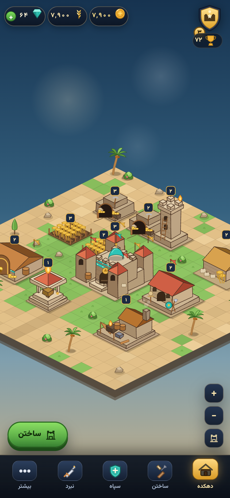
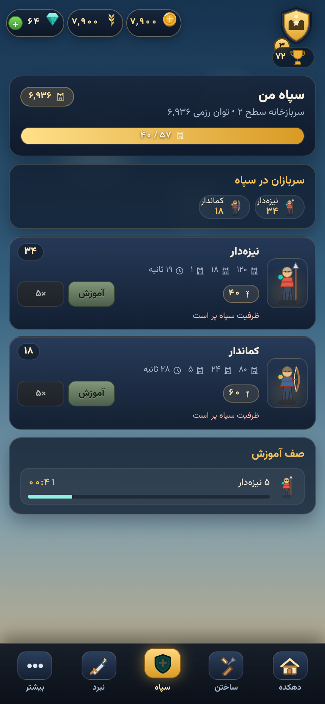
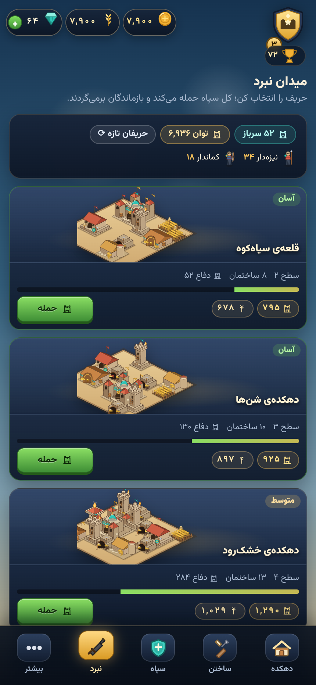
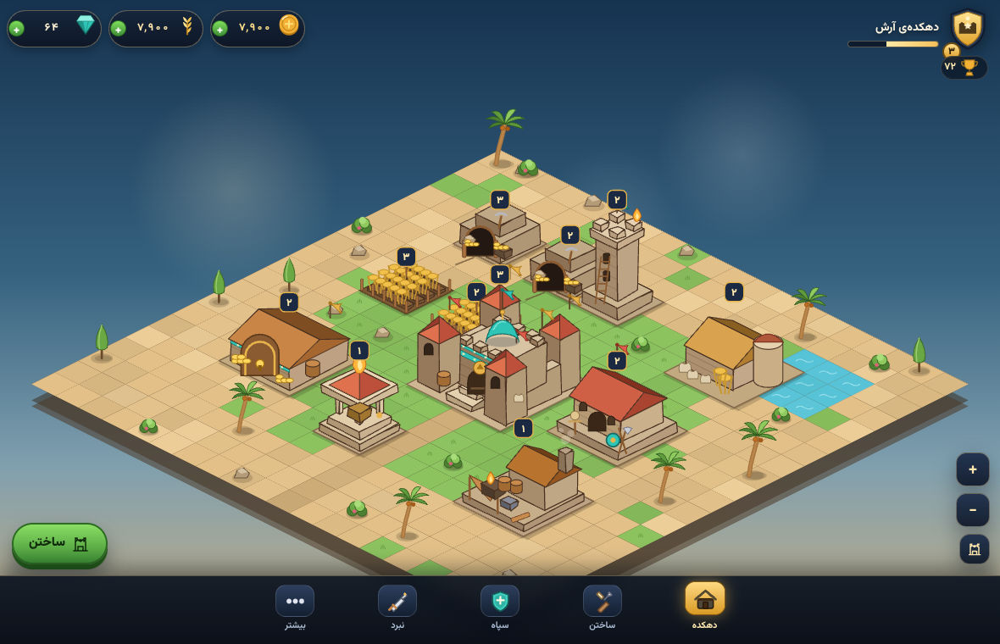

# 🏰 جنگاوران قلعه

> بازی استراتژی و آبادانی روستا، تحت وب و با حال‌وهوای ایرانی — الهام‌گرفته از سبک کلش آو کلنز، اما کاملاً بومی و مرورگری.

روستایت را روی شن‌های کویر بنا کن، معدن طلا و کشتزار گندم بساز، دیوار بکش، سپاهت را در سربازخانه آموزش بده و برای غنیمت به روستاهای دشمن بتاز. همه‌چیز در مرورگر اجرا می‌شود، بدون حساب کاربری و بدون سرور بازی.

---

## ✨ چه چیزی در بازی هست؟

| بخش | توضیح |
| --- | --- |
| 🏯 **آبادانی روستا** | شبکه‌ی ۲۰×۲۰، ساخت و ارتقای ساختمان با تایمر، محدودیت هزینه و جای‌گذاری هوشمند |
| 🪙 **اقتصاد** | معدن طلا، کشتزار گندم، انبارها و سقف ذخیره؛ درآمد حتی وقتی بازی بسته است (پیشرفت آفلاین) |
| ⚔️ **ارتش** | سربازخانه، صف آموزش، ظرفیت سپاه و گروهان‌های ایرانی: نیزه‌دار، کماندار، جاویدان و… |
| 🗺️ **نبرد** | انتخاب حریف، پیاده‌کردن سپاه، شبیه‌سازی خودکار نبرد، ستاره، غنیمت و تاریخچه |
| 🎨 **ظاهر ایرانی** | صحنه‌ی ایزومتریک ساخته‌شده با SVG، گنبد فیروزه‌ای و کاشی‌کاری، رابط راست‌چین، فونت وزیرمتن، اعداد فارسی و تاریخ جلالی |
| 📷 **دوربین بازی** | کشیدن صحنه با انگشت/ماوس، زوم با چرخ و دو انگشت، دکمه‌های بزرگ‌نمایی و بازگشت به نمای کامل |

## 🖼️ تصویرها

| دهکده (موبایل) | سپاه | نبرد |
| --- | --- | --- |
|  |  |  |



## 📍 وضعیت فعلی — موج ۱۱ از ۵۰ (۲۲٪)

بازی همین حالا در مرورگر قابل بازی است. چرخه‌ی کامل بازی برقرار شده است:

> **ساختن → آموزش سپاه → حمله به دشمن → گرفتن غنیمت → ارتقا و بزرگ‌تر شدن**

| قابلیت | وضعیت |
| --- | --- |
| دهکده‌ی تعاملی، ساخت و ارتقا، جابه‌جایی | ✅ موج ۴ و ۶ |
| اقتصاد: طلا، گندم، تولید، انبار و سقف | ✅ موج ۳ |
| ذخیره‌سازی، پیشرفت آفلاین، مهاجرت ذخیره | ✅ موج ۵ |
| ارتش: آموزش، صف، ظرفیت سپاه | ✅ موج ۷ و ۸ |
| نبرد: حریف، شبیه‌سازی، ستاره، غنیمت، تاریخچه | ✅ موج ۹ و ۱۰ |
| گرافیک ایزومتریک، دوربین کشیدنی، رابط بازی‌گونه، فونت وزیرمتن | ✅ موج ۱۱ |

موج‌های بعدی: دسترس‌پذیری و موبایل (۱۲)، دیوار و مسیریابی (۱۳)، برج و آتشگاه (۱۴)، حمله‌ی راهزنان (۱۵) و… .
نقشه‌ی کامل و وضعیت همه‌ی ۵۰ موج در [`docs/WAVES.md`](docs/WAVES.md) است و هر موج یک بخش کامل و تست‌شده از بازی است.

### شروع سریع بازی

1. در دهکده یک **معدن طلا** و یک **کشتزار گندم** بساز تا منابع جمع شود.
2. ارگ را ارتقا بده تا **سربازخانه** باز شود، سپس سربازخانه بساز.
3. در صفحه‌ی **ارتش** چند نیزه‌دار و کماندار آموزش بده.
4. در صفحه‌ی **نبرد** یک حریف انتخاب کن و با کل سپاه حمله کن.
5. با غنیمت، ساختمان‌ها را ارتقا بده و همین چرخه را ادامه بده.

---

## 🚀 اجرا

نیازمندی: Node.js نسخه‌ی ۲۰ یا بالاتر. هیچ وابستگی خارجی لازم نیست.

```bash
npm run dev       # اجرای بازی روی http://localhost:4173
npm test          # اجرای تست‌ها
```

برای اجرای بازی کافی است بعد از `npm run dev` آدرس `http://localhost:4173` را در مرورگر باز کنی. داده‌ی بازی در `localStorage` همان مرورگر ذخیره می‌شود.

---

## 🧭 ساخت ۵۰ موجی

این پروژه به‌صورت ۵۰ موج (فاز) ساخته می‌شود. هر موج:

1. **شروع** می‌شود: `npm run wave start <n>`
2. کد و تست همان موج نوشته می‌شود.
3. تست‌ها سبز می‌شوند: `npm test`
4. یادداشت موج در [`docs/CHANGELOG.md`](docs/CHANGELOG.md) ثبت می‌شود.
5. با پروژه ادغام و کامیت می‌شود: `wave <n>: <عنوان>`
6. صحت موج بررسی می‌شود: `npm run wave finish <n>` و `npm run wave:verify`

دستورهای ابزار موج:

```bash
npm run wave:status          # موج جاری چه وضعی دارد؟ شروع شده یا نه؟
npm run wave -- start 3      # شروع موج ۳
npm run wave -- finish 3     # تحویل موج ۳ (فقط با تست سبز و یادداشت چنج‌لاگ)
npm run wave:verify          # تست‌ها + سلامت مستندات موج‌ها
npm run wave:docs            # بازتولید docs/WAVES.md از روی docs/waves.json
```

---

## 🗂 ساختار پروژه

```text
castle-warriors-ir/
├─ index.html               # صفحه‌ی بازی
├─ server.mjs               # سرور توسعه‌ی بدون وابستگی
├─ assets/fonts/            # وزیرمتن (woff2، محلی و بدون CDN)
├─ styles/
│  └─ main.css              # سیستم طراحی بازی‌گونه و انیمیشن‌ها
├─ src/
│  ├─ main.js               # نقطه‌ی ورود، اکشن‌ها و حلقه‌ی بازی
│  ├─ core/                 # منطق خالص و تست‌پذیر (بدون DOM)
│  ├─ data/                 # کاتالوگ ساختمان‌ها و سربازها
│  ├─ ui/
│  │  ├─ art/               # موتور گرافیک SVG: هندسه، اسپرایت‌ها، صحنه، دوربین، پیکره‌ها
│  │  ├─ screens/           # دهکده، ساختن، سپاه، نبرد، بیشتر
│  │  ├─ shell.js           # نوار منابع، Dock و نشان بازیکن
│  │  └─ sheet.js           # برگه‌های پایین‌کش
│  └─ utils/                # قالب‌بندی فارسی و تصادفی بذردار
├─ tools/art-preview.html   # پیش‌نمایش همه‌ی ساختمان‌ها برای بازبینی گرافیک
├─ tests/                   # تست‌های node:test
├─ scripts/
│  └─ wave.mjs              # ابزار مدیریت ۵۰ موج
└─ docs/
   ├─ waves.json            # داده‌ی نقشه‌راه
   ├─ WAVES.md              # نقشه‌راه تولیدشده
   ├─ CHANGELOG.md          # رویدادنگار هر موج
   └─ ARCHITECTURE.md       # معماری فنی
```

معماری از قاعده‌ی «منطق خالص جدا از رابط» پیروی می‌کند: همه‌ی محاسبات بازی در `src/core` است و با `node:test` تست می‌شود؛ `src/ui` فقط نمایش می‌دهد.

### 🎨 گرافیک

همه‌ی گرافیک بازی **با کد SVG** ساخته می‌شود؛ هیچ فایل تصویری یا CDN در پروژه نیست:

- `src/ui/art/geo.js` — بلوک‌های پایه: مکعب ایزومتریک با لبه‌های ناهموار، سقف شیروانی، هرم، گنبد، کاشی‌کاری، پرچم، شعله، دود، نخل و سرو.
- `src/ui/art/sprites.js` — نقاشی اختصاصی هر ساختمان (ارگ با گنبد و برجک، معدن با دهانه و ارابه، کشتزار با مترسک، …).
- `src/ui/art/scene.js` — ساخت جزیره‌ی ۲۰×۲۰، زمین، تزئینات، لایه‌بندی عمق، نشان سطح و نوار ساخت.
- `src/ui/art/camera.js` — دوربین کشیدنی/زوم و قاب نمایش هوشمند.

برای دیدن همه‌ی ساختمان‌ها یک‌جا: `http://localhost:4173/tools/art-preview.html`

---

## 🧪 تست

```bash
npm test
```

تست‌ها با `node:test` اجرا می‌شوند و به مرورگر یا پکیج اضافه نیاز ندارند. هر موج باید با تست سبز تحویل شود؛ ابزار موج اجازه نمی‌دهد موج ناتمام تحویل داده شود.

---

## 🤝 مشارکت

- برای هر تغییر، اول موج مربوطه در `docs/waves.json` را فعال کن.
- منطق بازی را در `src/core` بنویس و تستش را در `tests/` بگذار.
- متن‌های بازی فارسی و راست‌چین باشند؛ اعداد با ارقام فارسی نمایش داده شوند.
- یادداشت موج را در `docs/CHANGELOG.md` کامل کن.

---

## 📜 مجوز

MIT — استفاده، تغییر و انتشار آزاد است. ساخته‌شده برای بازی‌کن‌های ایرانی.
